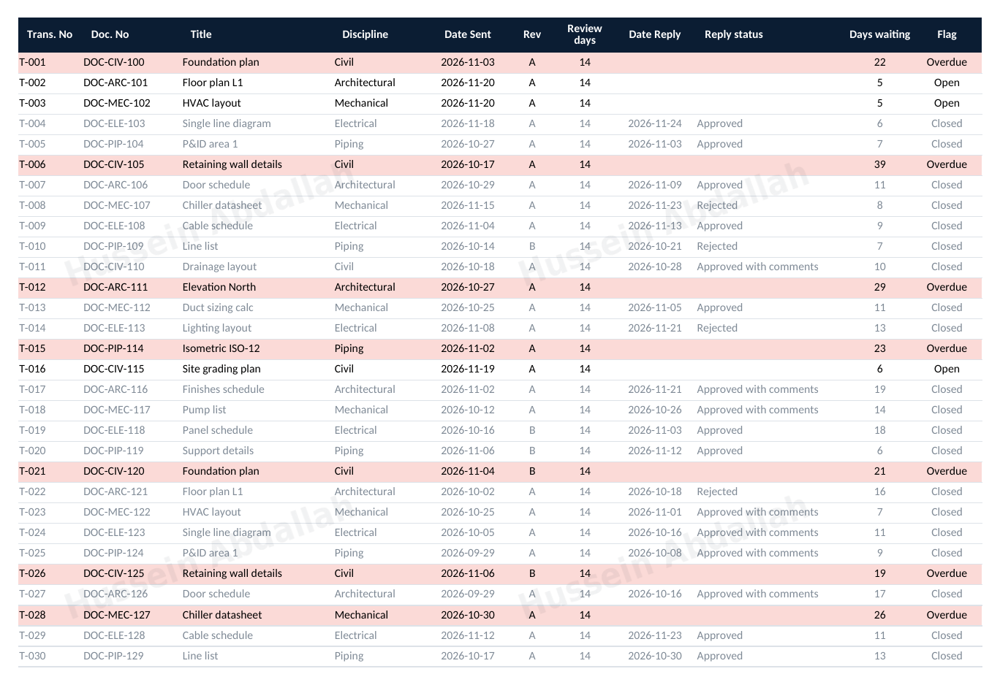
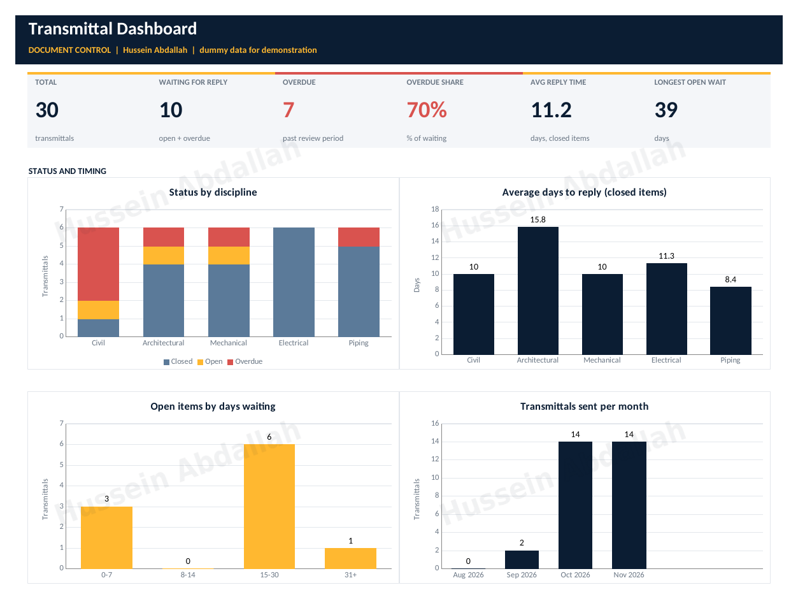

# Transmittal & Document Register Tracker (Excel)

An Excel workbook for tracking document transmittals: what was sent and when (transmittal number, document, discipline, revision), whether a reply came back, how many days it has been waiting, and which ones are overdue. The Dashboard sheet shows six key numbers and four charts.

All data in this workbook is dummy data made for demonstration. It contains no employer or project data.




## What is inside
| Sheet | Purpose |
|---|---|
| Register | One row per transmittal. Enter data here (formulas are ready down to row 500). Overdue rows turn red, closed rows turn grey, rows with a bad date turn yellow. |
| Dashboard | Six key cards (total, waiting, overdue, overdue share, average reply days, longest open wait), four charts, and the tables behind them. |
| Settings | Review period (default 14 days) and the lists used by the drop-downs. |
| Read me | Short usage notes. |

## The main formula
Days waiting (column J), with date sent in E and date of reply in H:

```
=IF(E2="","",IF(H2="",TODAY(),H2)-E2)
```

No reply yet: it counts up to today. Reply received: it counts to the reply date.

Flag (column K). A text date or a reply dated before the send date shows "Check date" instead of a wrong count:

```
=IF(E2="","",IF(NOT(ISNUMBER(J2)),"Check date",IF(J2<0,"Check date",IF(H2<>"","Closed",IF(J2>G2,"Overdue","Open")))))
```

## How to use it
1. Open `Transmittal-Tracker.xlsx`.
2. Go to Register. To clear the dummy data, select only the input columns (A to F, H and I) and press Delete. Do not delete columns G, J and K: they hold the formulas. Then add your own rows. Pick discipline and reply status from the lists.
3. Formulas in columns G, J and K are already filled to row 500. A row is counted once it has a Date sent. Past row 500, copy them down and extend the Dashboard ranges.
4. Change the review period in Settings, cell B2.
5. Read the Dashboard.

A step-by-step explanation of how it was built is in [WALKTHROUGH.md](WALKTHROUGH.md) (Arabic version: [WALKTHROUGH.ar.md](WALKTHROUGH.ar.md)).

## What the numbers mean
- Total: every row that has a Date sent. It equals Open + Overdue + Closed + Check date. A row with no Date sent (for example only a title) is ignored and shows no flag.
- Waiting: Open + Overdue. Overdue: waiting longer than the review period.
- Average reply time: average days waiting of Closed rows only.
- Longest open wait: the largest days waiting among Open and Overdue rows (0 if nothing is waiting).
- "Check date" rows (text date, or reply before send date) count in Total only. They are left out of every other number and the Dashboard shows a note.
- Days waiting shows `#VALUE!` when a date was typed as text. The Flag then says "Check date".

## How it was checked
The workbook was recalculated in LibreOffice and compared with an independent calculation in Python. Zero mismatches in all scenarios:
- the 30 dummy rows as shipped;
- new rows added at row 32, 33, 100 and 400, including an older month;
- review period changed to 3, 7 and 30 days (overdue moves 12, 9 and 3 on the test data, so the setting flows through);
- bad input: a text date, a text reply date, a reply before the send date, and a title-only row. Three rows are flagged "Check date", the title-only row is ignored;
- all rows open with none overdue (30 waiting, 0 overdue, longest open wait 10);
- an empty register (every number is 0, no errors).

Not checked: desktop Excel (the checks used LibreOffice), and phones. `MAXIFS` (Longest open wait) needs Excel 2019 or Microsoft 365. Because the formulas use `TODAY()`, the numbers change every day. The Dashboard shows the last 4 months counted from today.

## Rights
© 2026 Hussein Abdallah. All rights reserved for the original content. See [NOTICE.md](NOTICE.md).

Author: Hussein Abdallah, Document Controller.
